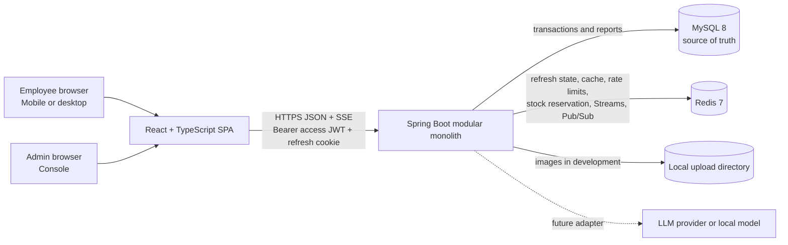
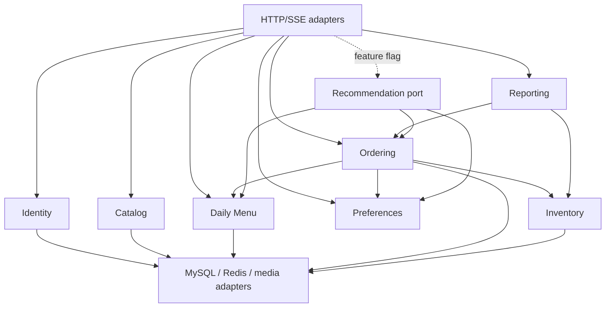

# System architecture

## 1. Context and deployment



The SPA and API are separate projects during development. Vite proxies `/api` and `/media` to Spring Boot so browser security behavior remains close to same-origin production. Public namespaces are deliberately separate: `/api/v1/app/**` for employee capabilities, `/api/v1/admin/**` for Console capabilities, and `/api/v1/auth/**` for token lifecycle. A production build can be served by a reverse proxy or Spring static resources; this does not merge the application layers.

## 2. Backend module boundaries



Modules expose application use cases and read models, not repositories. Cross-module calls use explicit interfaces. The database remains one physical schema. Redis reservations absorb the hot-stock race; MySQL remains the durable authority for orders, confirmed inventory, uniqueness, status history, idempotency completion, and reporting.

## 3. Critical order flow

```mermaid
sequenceDiagram
    participant UI as React checkout
    participant API as Ordering API
    participant REDIS as Redis Lua + Stream
    participant WORKER as Inventory consumer
    participant DB as MySQL
    participant OUT as Outbox publisher
    participant SSE as Connected menu clients

    UI->>API: POST /api/v1/app/orders + Idempotency-Key
    API->>DB: claim idempotency submission; validate user/slot/catalog/prices
    API->>REDIS: Lua: check all quantities, decrement, save reservation, XADD atomically
    alt Redis has insufficient stock
        REDIS-->>API: rejected items and exact remaining values
        API->>DB: mark submission failed
        API-->>UI: 409 INVENTORY_INSUFFICIENT
    else reserved
        REDIS-->>WORKER: durable reservation event
        WORKER->>DB: idempotent transaction: conditional stock update, order snapshots, movements, history, outbox
        alt durable confirmation completes in request wait budget
            DB-->>API: submission COMPLETED + order ID
            API-->>UI: 201 order and resolved delivery information
        else still processing
            API-->>UI: 202 submission ID; retry/poll with same key
        end
        OUT->>REDIS: publish confirmed stock/dashboard event
        REDIS->>SSE: fan out versioned stock event
        SSE-->>UI: update TanStack Query cache
    end
```

All stock keys for a delivery date use one Redis Cluster hash tag so a Lua script can check every requested dish, decrement them, persist a reservation record, and append its Redis Stream event atomically. A consumer group performs MySQL conditional updates in stable item-ID order. It creates the order only after every update succeeds, and uses the reservation/idempotency ID as a unique deduplication key.

The asynchronous boundary is internal: **a Redis reservation alone is never an accepted order**. The API waits briefly for durable confirmation; on timeout it returns `202 Processing`, and the frontend polls/retries the submission with the same idempotency key. Only a MySQL-confirmed order returns `201` and appears as `Pending`.

Failure handling is explicit:

- consumer crash before commit leaves the Stream entry pending for redelivery;
- crash after commit but before acknowledgement is harmless because the MySQL deduplication key returns the existing order;
- a terminal MySQL conflict triggers an idempotent Redis compensation and a failed submission;
- Redis loss before MySQL confirmation cannot produce a false success;
- Redis loss after MySQL confirmation is repaired from MySQL by reconciliation, while the existing order remains durable;
- scheduled reconciliation compares Redis values, `daily_menu_item`, and the movement ledger, alerts on drift, and rebuilds only from MySQL-confirmed state.

Redis uses AOF and a `noeviction` policy for reservation/Stream keys. MySQL still uses `UPDATE ... WHERE remaining_stock >= ?` as the last invariant, so Redis split-brain or stale initialization fails safely rather than overselling.

## 4. Consistency model

| Data | Authority | Cache/event behavior | Consistency guarantee |
|---|---|---|---|
| Users, preferences, dishes, orders | MySQL | Redis entries invalidated after committed outbox event | DB read is authoritative |
| Menu metadata | MySQL | Redis cache-aside, versioned keys, 5-minute TTL; admin mutations invalidate | Bounded staleness for browse; checkout revalidates |
| Inventory reservation | Redis Lua + Stream | Atomic all-item reservation; reservation is not final success | Serialized admission, recoverable processing |
| Confirmed inventory | MySQL `remaining_stock` + ledger | Post-confirmation version/value pushed over SSE; periodic reconciliation | Durable invariant and reporting authority |
| Refresh token family | Redis hashed rotating token state | TTL, reuse detection, logout revocation | Long-lived login without exposing refresh token to JavaScript |
| Dashboard | MySQL aggregate queries | 15-second cache; order/menu events invalidate | Real order source, near-real-time display |
| Idempotency | MySQL unique submission record | Reservation ID links Redis and consumer | Durable duplicate prevention and processing lookup |

Versioned confirmed-stock events let clients and cache writers ignore out-of-order delivery. If post-commit publication fails, the MySQL outbox retains the event for retry. Menu reads can bypass a failed metadata cache. New orders fail closed when reservation Redis is unavailable; existing short-lived access JWTs remain usable until expiration, while refresh requires Redis recovery.

## 5. Security and trust boundaries

- Spring Security owns authentication and authorization. Passwords are BCrypt hashes and never logged.
- Login returns a 10–15 minute signed access JWT for in-memory client use and sets a rotating 7–30 day opaque refresh token cookie. The refresh cookie is `HttpOnly`, `SameSite=Strict` (or `Lax` if deployment navigation requires it), path-scoped to `/api/v1/auth`, and `Secure` outside local development. Only a token hash/family record is stored in Redis.
- `JwtAuthenticationFilter` extends `OncePerRequestFilter`, validates signature/issuer/audience/expiry, and creates one immutable `AuthenticatedActor(userId, role)` in Spring's `SecurityContext`. Controllers obtain it with `@AuthenticationPrincipal`; application use cases receive an explicit `CurrentActor` rather than reading a custom global `ThreadLocal`.
- The requested “unified permission interceptor” is implemented at the Spring Security filter layer, not as an MVC `HandlerInterceptor`, because authentication must run before controller mapping and must integrate with SecurityContext, exception handling, and method authorization.
- One `SecurityFilterChain` applies namespace rules: `/api/v1/app/**` requires `EMPLOYEE`, `/api/v1/admin/**` requires `ADMIN`, and token endpoints use explicit public/authenticated rules. Method-level ownership and transition checks remain mandatory, so URI checks are not the only protection.
- Refresh rotates on every use. Reuse of an old token revokes the whole family. Logout revokes the family; access JWTs expire naturally or can be denied by a short TTL revocation key for high-risk logout.
- Request DTOs use Jakarta Bean Validation and explicit maximum lengths. JPA/parameterized SQL prevents SQL injection; user sort fields map through an allowlist.
- Login and order endpoints use Redis-backed token-bucket limits by IP and authenticated user. A Redis limiter failure uses conservative local limits and emits an alert.
- Uploads allow JPEG/PNG/WebP, verify decoded MIME type, cap size and dimensions, generate server filenames, and store only relative URLs. Executable/SVG input is rejected.
- Error responses use stable English codes and safe messages; stack traces and SQL details never cross the API boundary.

## 6. Reliability and operations

- Flyway owns schema evolution; no `ddl-auto=update`. Startup validates the schema.
- Liveness reports process state. Readiness checks MySQL and reservation Redis; short-lived access-token verification itself remains local.
- JSON logs include correlation ID, route, latency, status, and non-sensitive user/order identifiers.
- Metrics cover request latency, cache hit ratio, rate-limit rejection, order outcomes, inventory conflicts, SSE connections, outbox lag, and dashboard query time.
- Graceful shutdown stops accepting traffic, drains requests, and closes SSE connections with a reconnect hint.
- Daily reconciliation compares order-item quantities against inventory movements; an `inventory_movement` ledger makes anomalies auditable.
- Database backups and restore tests are deployment concerns; local development keeps uploaded media under a documented persistent path.

## 7. AI recommendation extension

The `recommendation` module defines `RecommendationProvider.recommend(RecommendationContext)` and does not depend on a specific LLM SDK. Context contains the English prompt, sanitized preferences, available/non-sold-out menu, allergen exclusions, and dish IDs ordered in the previous seven days.

Safety and correctness remain outside the model:

1. The application removes allergen and sold-out candidates before sending context.
2. The provider returns structured dish IDs plus reasons, never authoritative dish data.
3. The application validates returned IDs again and hydrates current cards from the menu module.
4. `/api/v1/app/recommendations/stream` uses SSE events (`status`, `recommendation`, `complete`, `error`) so the UI can progressively render cards.
5. A feature flag hides the entry when no provider/API key is configured. Provider secrets live only in environment variables.

This seam supports Spring AI/OpenAI-compatible APIs or a local model later without changing menu/cart contracts.

